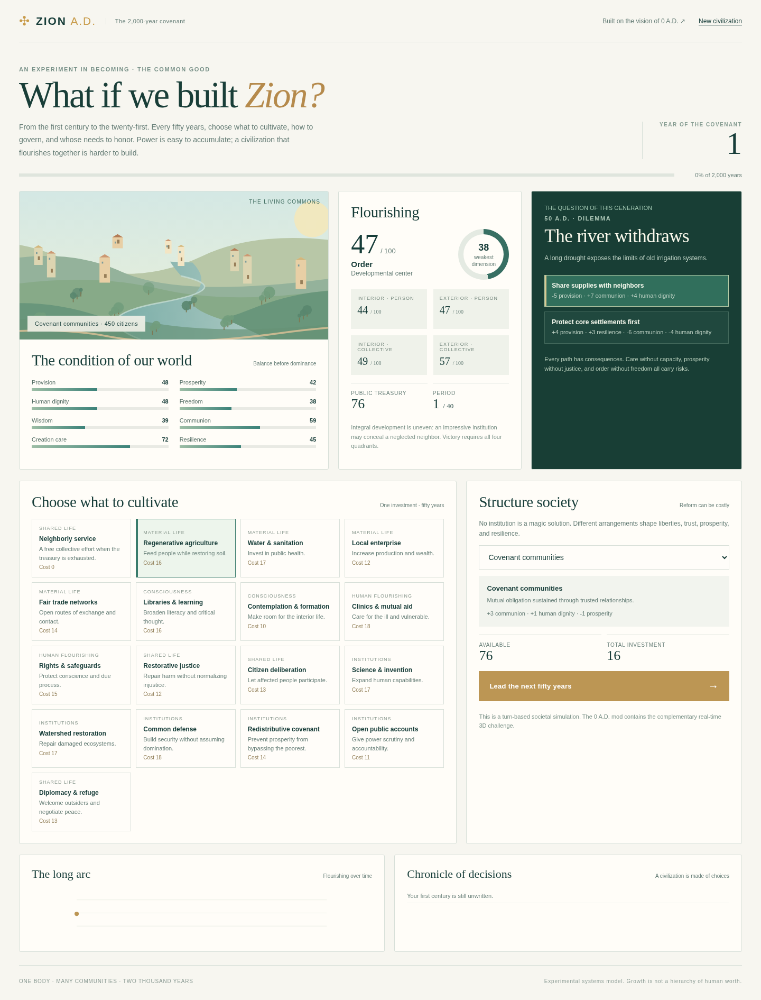

# Zion A.D. — The Two-Thousand-Year Covenant

**An experimental, fully editable post-conquest civilization game.**

A world can be conquered without being healed. Zion A.D. asks a harder question: Can a society cultivate provision, prosperity, dignity, freedom, wisdom, communion, creation care, and resilience across 2,000 years?



## What's playable in version 0.1.0?

There are **two companion experiences**, intentionally at different levels of maturity:

1. **Turn-based browser campaign** (complete, offline-capable mechanics). Lead one civilization through 40 fifty-year generations, from year 1 to year 2000. Select among 17 public investments and 7 forms of governance, confront 18 dilemmas, observe persistent societal consequences, and pursue a four-quadrant flourishing objective. Every action is playable; the browser saves progress locally.
2. **0 A.D. Release 28 mod** (experimental and not yet tested inside the real Pyrogenesis executable). Enables a *Zion A.D. — 2000 Years* victory condition in 0 A.D.'s skirmish settings. The engine supplies its existing 3D world, constructions, unit behaviors and resources. The script tracks societal indicators, reports developmental milestones each century, modifies food availability during moments of thriving/imbalance, and tests for flourishing in year 2000 after approximately 50 minutes at 1× speed.

The two experiences share a deterministic, human-readable scoring core (`maps/scripts/ZionCore.js`) but have **distinct implementations of player agency**. The browser offers explicit governance and political decisions. The 0 A.D. mod presently offers the ordinary RTS actions as proxies; it does *not yet* provide a native political-policy menu, century-by-century dilemmas, or a true historical 3D technology ladder.

## Play the campaign immediately

Open the companion `zion-ad-play.html` file from the download. It is a single, self-contained HTML file that needs no installation or account. Alternatively open `web/index.html` **from the source tree**, keeping its adjacent CSS/JS files and the `maps/scripts/` folder in place. Your progress is kept in browser local storage.

## Try the 3D 0 A.D. mod

Requires **0 A.D. Release 28 (0.28.0)**. Download from [play0ad.com](https://play0ad.com/).

1. Download `zion-ad-0.1.0.pyromod`.
2. Open it with 0 A.D., or extract the archive to your user mod directory in a folder named `zion_ad`. The archive places `mod.json` at its root, as required.
3. In 0 A.D., go to **Settings → Mod Selection** and activate **Zion A.D.**; save/restart.
4. Create a skirmish match and, in **Victory Conditions**, **uncheck Conquest** and select **Zion A.D. — 2000 Years**. A peaceful match without an attacking AI is the best starting configuration. Use a large map and generous population cap.
5. Build farms and houses for provision and dignity; markets for trade; temples and healers for wisdom and care; carefully balance security, defense and land use. Century notifications track your score. Reach year 2000 with flourishing across all four quadrants.

Mod locations (when manually extracting):
- Windows: `Documents/My Games/0ad/mods/zion_ad/`
- macOS: `~/Library/Application Support/0ad/mods/zion_ad/`
- Linux: `~/.local/share/0ad/mods/zion_ad/`

The install and in-game mechanics above are based on upstream Release 28 / preceding examples. **We could not launch the actual 0 A.D. binary in this development environment**, so compatibility remains to be confirmed on a real installation; automated scripts were tested with an engine simulator.

## Development

```sh
node --test tests/*.test.js
python scripts/build.py
```

The source bundle includes an interactive web prototype, all native mod scripts, test harnesses, docs, and build tooling. No database, build framework or network dependency is needed for play. The optional Google Fonts import falls back to local fonts offline.

## Philosophy and mechanics

**Zion is a direction of collective transformation, not a military destination.**

- **Four quadrants:** inner person (wisdom and dignity); outer person (provision and resilience); inner collective (communion and freedom); outer collective (prosperity and creation care).
- **Seven developmental centers:** survival, belonging, order, achievement, pluralism, integration, and planetary care. These are *game heuristics*, not a ranking of persons or real-world cultures. All capacities matter; stages can regress; no one is forced into a single strategy or governance model.
- **Plural institutions:** covenant communities, councils of elders, sacred monarchy, constitutional charters, mercantile republics, participatory assemblies, and federated commons. Each carries strengths and tradeoffs. Structure can change.
- **The victory constraint:** the 2,000-year campaign concludes with aggregate flourishing of at least 76/100, a floor of at least 62 across every dimension, and quadrants at least 70/100. A successful player cannot simply maximize wealth, military power, or a single fashionable value.
- **Christological orientation:** the last-first principle, restoration rather than domination, neighbor love and solidarity with outsiders animate the game's dilemmas. The model never treats coercive conversion or imposed conformity as victory.

This is a normative artistic game design, not a scientific instrument. Outcomes are deliberately debatable and meant to be improved through playtesting, scholarship and community discussion.

## License and upstream relationship

Zion A.D. is an **independent, unofficial 0 A.D. modification**; not developed, sponsored or endorsed by Wildfire Games. Original Zion A.D. scripts and documentation are released under **GPL-2.0-or-later**; see `COPYING`. No upstream art, binaries, or source tree are redistributed in this package. The installed 0 A.D. engine/art remains separately licensed by Wildfire Games (GPL-2-or-later code and CC BY-SA 3.0 art). If this mod grows into a full engine fork and repackages those assets, preserve all corresponding licensing and attribution requirements.

**Official upstream development:** https://gitea.wildfiregames.com/0ad/0ad  
**Archived Git mirror:** https://github.com/0ad/0ad  
**Original game:** https://play0ad.com/

## Known limitations

See [`docs/ROADMAP.md`](docs/ROADMAP.md). The native RTS version is a **first vertical slice**: it reinterprets existing buildings/resources rather than yet replacing them with original Zion-specific civilizations, generations, economics, 3D art, citizen AI, social institutions, and dilemmas. The browser game already has the richer social simulation, though with 2D illustration instead of 0 A.D.'s full graphical engine. The next architectural milestone is to integrate that richer simulation natively in Pyrogenesis.
